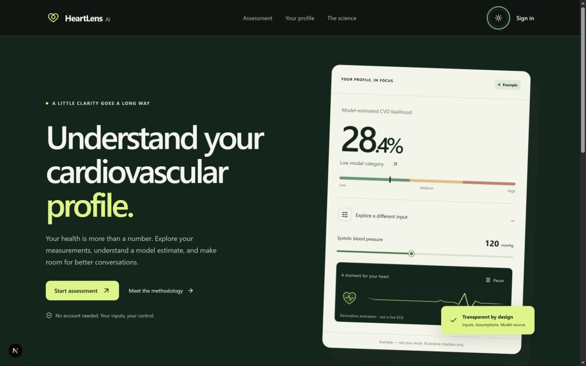

# HeartLens AI

A responsive educational cardiovascular profile application with genuine Python model inference, a focused assessment flow, same-model scenarios, and optional saved reports.

**Made with Love Himanshu Chauhan**

Deployment target: Vercel team `himchp-2600`, with the Next.js frontend and a private FastAPI service in one deployment. The Vercel Services feature is in beta. The root `vercel.json` defines both services; do not select only `apps/web` as the project root. See [deployment setup](docs/DEPLOYMENT.md) for required private environment variables and database setup. GitHub Pages remains an optional manual frontend-only workflow.

**Interface redesign and adaptation by Himanshu Chauhan.** Adapted from [the upstream cardiovascular-risk application](https://github.com/shlokkvaishnav/cardiovascular-risk), baseline `1308460473b9f67eeb8fe5513c1540cbad393a8f`. The original [MIT license](LICENSE) and copyright notice are preserved.

The score is **model-estimated cardiovascular disease likelihood**: disease presence in the source dataset, with no future-event horizon. It is an educational classifier output, not a diagnosis. Model failures produce a recoverable error, never an invented score.



## Run locally

Tested environment: Node 24.21.0 / npm 11.19.0 and Python 3.12.14 on Windows. Use Node 24 (`.nvmrc`) and Python 3.12. This machine used the bundled Codex Python to create `backend/.venv`; the `py -3.12` setup line below assumes the standard Windows Python launcher is installed. The frontend and backend run separately; optional accounts can use SQLite without PostgreSQL or a paid provider.

From the repository root, create and install the backend environment:

```powershell
py -3.12 -m venv backend/.venv
backend/.venv/Scripts/python.exe -m pip install -e './backend[dev,viz]'
backend/.venv/Scripts/python.exe scripts/fetch_upstream_data.py
cd backend
$env:MPLCONFIGDIR=Join-Path (Get-Location) "logs/matplotlib"
.venv/Scripts/python.exe scripts/train.py --config config/config.quick.yaml
$env:DATABASE_URL='sqlite:///./heartlens.db'
$env:JWT_SECRET_KEY='local-development-secret-change-before-production'
.venv/Scripts/python.exe -m uvicorn src.api.app:app --host 127.0.0.1 --port 8000
```

In another terminal:

```powershell
cd apps/web
npm ci
npm run dev
```

Open [HeartLens AI locally](http://127.0.0.1:3000). The Next.js server proxies `/api/*` to FastAPI and injects the development service key. For a custom key set the same **server-side** `API_KEY` in both terminals; set `API_URL` in the frontend terminal for a different backend. Shell environment variables are not automatically imported from the root `.env` by native Python; Compose does read `.env`.

On macOS/Linux use `python3.12 -m venv backend/.venv`, `backend/.venv/bin/python` and standard `export NAME=value` syntax. Install platform requirements for LightGBM/OpenMP if needed. Do not load arbitrary downloaded pickle files.

Quick training runs the original data and feature pipeline with Logistic Regression, LightGBM and XGBoost candidates, no tuning/screening/stacking, and isotonic calibration. It produces a **development model**; exact selected estimator, artifact hash, data/config hashes and measured metrics belong to that run. Run `scripts/train.py --config config/config.yaml` from `backend` for the full search. Training may take substantial time. No upstream historical accuracy is presented as the new model's measured result.

## Delivered development artifact

| Item | Actual result |
|---|---|
| Selected model | LightGBM with isotonic calibration |
| Artifact version | `b532dbf82fe5` |
| Held-out rows | 20,913 |
| Accuracy / ROC AUC / Brier | 0.74135705 / 0.80359082 / 0.17945700 |

These are measured results for the delivered quick development run, not clinical validation or a full tuned search. The original training policy continued despite 17 out-of-range BMI and 10 interaction values; see validation and model card. The complete artifact hash and dependency versions are recorded in generated training metadata.

## Try the sample reports

Download one of the four synthetic PDFs from the assessment welcome screen, open **Upload a lab report instead**, read the disclosure, accept processing, and choose the file. Every imported field remains editable. Complete contextual history, review assumptions, then request a genuine prediction. The four marked samples work without Groq; general reports still require its configured provider. See [sample guide](docs/SAMPLES.md).

From the repository root, the real local checks can be repeated with:

```powershell
backend/.venv/Scripts/python.exe scripts/verify_sample_import.py
backend/.venv/Scripts/python.exe scripts/verify_local_integration.py
```

The integration script creates disposable synthetic accounts in the local database. Sample generation is reproducible with `scripts/generate_sample_reports.py` (ReportLab required).

## Experience and architecture

- Original light/dark editorial UI, responsive navigation, accessible form controls and reduced-motion support.
- Guest assessment, session drafts, canonical measurement units, explicit unknowns/assumptions, optional external report import and editable review.
- Genuine predictions, model identity/timestamps, same-artifact backend scenarios, device history and CSV/print.
- Heart-and-wave monitor illustration with pause and reduced-motion support. It is decorative, not a live ECG.
- Four downloadable synthetic lab PDFs with local, deterministic import and mandatory review. General report extraction remains optional through Groq.
- Category-only sharing by default; detailed health-bearing links require explicit disclosure/choice. Shared scores are never accepted as authenticated inference.
- Optional registration/login, account history, server-recomputed saves, report detail/PDF and logout.
- Methodology/privacy routes, prediction/batch APIs, health/model information and optional monitoring/extraction tooling.

`apps/web` uses Next.js App Router, React, TypeScript, Tailwind and Framer Motion. `backend` uses FastAPI, scikit-learn, LightGBM/XGBoost, Optuna, MLflow, DVC and optional SQLAlchemy/PostgreSQL. `apps/web/proxy.ts` holds the server credential boundary; no private service key is needed in browser bundles.

### Inputs and semantics

`POST /predict` requires eleven raw inputs:

| Field | Unit or values |
|---|---|
| `age` | years |
| `sex` | 0 female, 1 male (dataset encoding) |
| `height`, `weight` | cm, kg |
| `ap_hi`, `ap_lo` | mmHg; systolic minus diastolic at least 10 |
| `cholesterol`, `gluc` | 1 normal, 2 above normal, 3 well above normal |
| `smoke`, `alco`, `active` | 0/1 |

Numeric cholesterol mapping uses <200 / <240 / ≥240 mg/dL. This is an approximation to the dataset's reported categories. Glucose category is reported explicitly; diabetes history is contextual and no longer substitutes for a measured glucose category. HDL, family history and BP medication are contextual, not model inputs. Missing values need explicit review/assumption consent.

Raw age-days and gender 1/2 are normalized during training. BP repair/clipping, duplicate handling, eighteen derived model columns, preprocessing and calibration remain in the original pipeline. Serving and training share derived feature code. Bands are Low ≤0.4, Medium >0.4 through 0.7, High >0.7. Confidence is the larger class probability, not validated certainty.

Responses include `contract_version`, `source`, `target`, model name/version, artifact SHA256, probability, category and timestamp. Raw-estimator SHAP is **not** shown as a contribution to a calibrated probability. For the delivered calibrated model those explanations are unavailable with a reason. Heart age is not a trained output.

### Data and privacy

The default CSV is already committed upstream; the DVC remote is only a local-folder configuration. See [provenance](docs/PROVENANCE.md) for dataset hash and unresolved redistribution licensing verification.

Drafts use session storage; device history and optional auth tokens persist in local storage. Explicit account saves use the configured database and recompute predictions server-side with artifact provenance and assumptions. Legacy reports/history remain labeled unknown. Marked synthetic samples are parsed locally; general lab import sends report content to Groq only after user consent and requires `GROQ_API_KEY`; manual entry remains available without it. Uploads are PDF/DOCX, limited to 10 MB, and reviewed before prediction. Sensitive extraction output is not logged. Category-only share text contains no inputs; detailed links contain health inputs and Base64 is not encryption.

## Verify

From `apps/web`:

```sh
npm run lint
npx tsc --noEmit
npm test
npm run build
```

From `backend` with its environment active:

```sh
python -m pytest tests/ -q
python -m black --check src/ tests/
python -m flake8 src/ tests/ --count --select=E9,F63,F7,F82 --show-source --statistics
```

A successful `/health` alone is insufficient: require `model_loaded=true` and a real 200 prediction. The real-artifact regression test refuses to pass with an absent model. See [validation evidence](docs/VALIDATION.md) for actual results, browser dimensions, screenshots and unverified gates. Performance goals in the brief are targets until measured.

Production dependencies currently audit clean; development lint tooling retains an upstream `braces` advisory chain. A forced fix would downgrade Next.js's lint configuration incompatibly; this is documented rather than silently applied.

## Documentation

- [Design system](docs/DESIGN.md)
- [Capabilities before/after](docs/CAPABILITIES.md)
- [Provenance and attribution](docs/PROVENANCE.md)
- [Implementation checkpoint](docs/IMPLEMENTATION_STATUS.md)
- [Validation and limitations](docs/VALIDATION.md)
- [Deployment modes](docs/DEPLOYMENT.md)
- [Viva and reproducible demo](docs/VIVA.md)
- [Model card](backend/MODEL_CARD.md)

No application code has been pushed or deployed. Faculty and group details remain configurable; none are invented.
